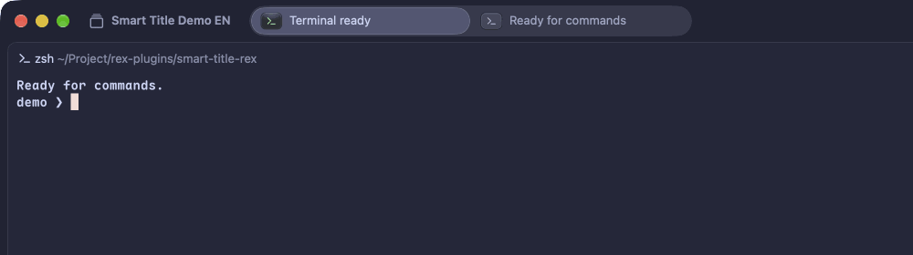

<h1 align="center">🏷️ smart-title-rex</h1>
<p align="center">
    <em>Rex tabs that name themselves, so you stop reading <code>Window 17305fcc</code></em>
</p>

<p align="center">English · <a href="README.zh-CN.md">简体中文</a></p>

`smart-title-rex` is a Rex plugin, installed with [lazy.rex](https://github.com/TaterDoge/lazy.rex). It watches your tabs, sends the focused terminal's recent output to an OpenAI-compatible chat-completions model, and renames the tab to a short title that says what the tab is doing — not the folder or process name.

It follows the Rex server: starts after the config loads, restarts on `rex config reload`, and exits when the server stops. No manual start command.



## Requirements

- Rex and Git on the same machine: lazy.rex clones the plugin on first install.
- An OpenAI-compatible chat-completions endpoint (OpenAI, Magpie, OpenRouter, a local server, …).
- `/usr/bin/curl` 8.3+ on the Rex server (used to pass the API key through the environment, not the command line).
- The `rex` executable: taken from `PATH`, otherwise from the running Rex server itself.

## Installation

Declare the plugin in `~/.config/rex/lua/plugins/smart-title.lua`, as a [lazy.rex](https://github.com/TaterDoge/lazy.rex) spec:

```lua
return {
  "taterdoge/smart-title-rex",
  main = "smart-title-rex",
  opts = {
    url = "https://api.openai.com/v1/chat/completions",
    api_key = os.getenv("OPENAI_API_KEY") or "",
    model = "gpt-4o-mini",
  },
}
```

Then install and reload:

```sh
rex --timeout 30s do lazy_install
rex config reload
```

lazy.rex installs into `<root>/<name>`, `$XDG_DATA_HOME/rex/lazy` by default. `opts` is what makes it call `setup`; without `opts` or `config = true` the plugin is only added to `package.path`. If lazy.rex itself is not installed yet, follow its [bootstrap instructions](https://github.com/TaterDoge/lazy.rex#bootstrapping).

For a local checkout during development, use `dir` instead of the Git source:

```lua
return {
  dir = "/absolute/path/to/smart-title-rex",
  name = "smart-title-rex",
  opts = { ... },
}
```

Local `dir` plugins are managed by you: lazy.rex neither installs nor updates them.

## Configuration

| Option | Default | Meaning |
| --- | --- | --- |
| `url` | `https://api.openai.com/v1/chat/completions` | Full chat-completions endpoint, not just the API base URL |
| `api_key` | `""` | Bearer token. Empty sends no `Authorization` header, for local endpoints |
| `model` | `gpt-4o-mini` | `model` value in the request body |
| `language` | `English` | Language of the generated title, as a name the model understands: `"English"`, `"Chinese"`, `"Japanese"` |
| `reasoning_effort` | unset | Optional provider-specific value. `"none"` skips reasoning where supported, so the output budget goes to the title |
| `poll_interval` | `30` | Seconds between fallback scans |
| `poll_all_tabs` | `false` | `true` scans every tab; `false` only each session's active tab |

Values are validated at config load. `url` must be HTTP(S), `poll_interval` a positive number, `poll_all_tabs` a boolean, `language` a non-empty name without line breaks.

```lua
opts = {
  url = "http://localhost:3425/v1/chat/completions",
  api_key = "magpie",
  model = "inceptionlabs/mercury-3",
  language = "English",
  reasoning_effort = "none",
  poll_interval = 30,
  poll_all_tabs = false,
},
```

`max_tokens` is fixed at 1024 as a safety cap. It limits output, not spending: providers bill actual generated tokens, and title length is controlled by the prompt.

## How tabs get titled

Titles are generated when:

- the plugin loads, for each session's active tab;
- a tab or session is created;
- a tab becomes the active tab;
- the foreground process changes (a command starts or finishes);
- the working directory or terminal title changes;
- the fallback scan runs every `poll_interval` seconds.

Event-driven updates are debounced for 2 seconds. The fallback scan covers each session's active tab; with `poll_all_tabs = true`, every tab.

Before calling the model the plugin:

- reads only the tab's focused terminal, not every pane;
- sends only its last 12 KiB, not the full scrollback;
- skips panes that are not terminals or are blank;
- skips content identical to the last request for that tab, so idle tabs cost nothing.

Tab titles are replaced whenever content changes; manually renamed tabs are not protected.

## Manual controls

The watcher starts with Rex. These actions only pause and resume it:

```sh
rex do smart_title_stop    # stop until the next config reload or server restart
rex do smart_title_start   # restart without reloading
```

`rex config check` may execute plugin setup, but its child exits before scanning terminals or calling the model.

## Privacy

Terminal text leaves the Rex server and goes to the endpoint configured in `url`. Do not point the plugin at a provider you would not send terminal output to.

The API key is passed to `curl` through an environment variable, never as a process argument. The plugin does not log the request body or the key; the watcher receives its configuration through `SMART_TITLE_CONFIG`, which contains the key, so do not log that variable.

## How it works

```
Rex config load → start_watcher (Rex action)
  └─ /bin/sh launcher.sh
       ├─ resolves rex (PATH, else the server binary)
       └─ rex --autostart=false do daemon.lua --all
            ├─ watches window/terminal events and polls
            ├─ reads the focused terminal via the Rex block API
            └─ POST {url} with curl
```

- `launcher.sh` retries while the server is not ready, and supervises the daemon.
- `daemon.lua` exits when its config generation is superseded or its parent process disappears.
- Config reload replaces the watcher, so new `opts` apply without restarting Rex.

## Development

```sh
luajit tests/test.lua
rex config check ~/.config/rex/init.lua
```

Tests stub Rex and HTTP; they do not prove a real provider's response compatibility.
