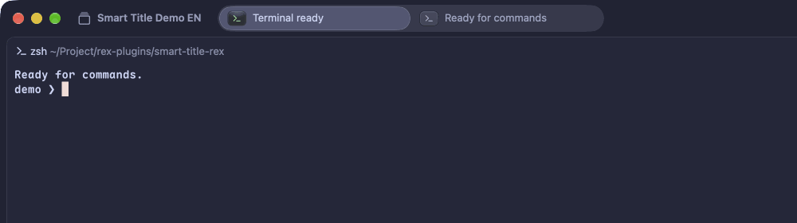

<h1 align="center">🏷️ smart-title-rex</h1>
<p align="center">
    <em>自己会取名的 Rex 标签页，不用再读 <code>Window 17305fcc</code></em>
</p>

<p align="center"><a href="README.md">English</a> · 简体中文</p>

`smart-title-rex` 是一个用于 Rex 的 [Amber](https://github.com/rawnly/amber) 插件。它监视你的标签页，把获得焦点的终端最近的输出发给一个兼容 OpenAI 的 chat-completions 模型，然后把标签页改成一个短标题——说明这个标签页在做什么，而不是文件夹名或进程名。

它跟随 Rex 服务：配置加载后启动，`rex config reload` 时重启，服务停止时退出。没有手动启动命令。



*用 t-rec 在 Rex 中录制。两个标签页、两个任务、自动标题；等待的空档已剪短。*

## 环境要求

- Rex 和 Amber 在同一台机器上。
- 一个兼容 OpenAI 的 chat-completions 接口（OpenAI、Magpie、OpenRouter、本地服务……）。
- Rex 服务器上有 `/usr/bin/curl` 8.3+（用于通过环境变量而非命令行传递 API key）。
- `rex` 可执行文件：优先取 `PATH`，否则取自正在运行的 Rex 服务器自身。

## 安装

在 `~/.config/rex/init.lua` 的 `amber.setup({ plugins = ... })` 中加入该插件：

```lua
{
  "taterdoge/smart-title-rex",
  main = "smart-title-rex",
  opts = {
    url = "https://api.openai.com/v1/chat/completions",
    api_key = os.getenv("OPENAI_API_KEY") or "",
    model = "gpt-4o-mini",
  },
},
```

然后安装并重载：

```sh
rex do amber_install
rex config reload
```

开发时使用本地代码副本，可加上 `path = "/absolute/path/to/smart-title-rex"`。`path` 形式的本地插件由外部管理：不要对它们运行 `amber_install`。

## 配置

| 选项 | 默认值 | 含义 |
| --- | --- | --- |
| `url` | `https://api.openai.com/v1/chat/completions` | 完整的 chat-completions 接口地址，不是单纯的 API base URL |
| `api_key` | `""` | Bearer token。为空时不发送 `Authorization` 头，适用于本地接口 |
| `model` | `gpt-4o-mini` | 请求体中的 `model` 值 |
| `language` | `English` | 生成标题使用的语言，写成模型能理解的语言名：`"English"`、`"Chinese"`、`"Japanese"` |
| `reasoning_effort` | 未设置 | 可选的、由服务商定义的值。在支持的情况下 `"none"` 会跳过推理，把输出预算留给标题 |
| `poll_interval` | `30` | 兜底扫描的间隔秒数 |
| `poll_all_tabs` | `false` | `true` 扫描所有标签页；`false` 只扫描每个会话的活动标签页 |

配置加载时会校验取值。`url` 必须是 HTTP(S)，`poll_interval` 必须是正数，`poll_all_tabs` 必须是布尔值，`language` 必须是非空且不含换行的名字。

```lua
opts = {
  url = "http://localhost:3425/v1/chat/completions",
  api_key = "magpie",
  model = "inceptionlabs/mercury-3",
  language = "English",
  reasoning_effort = "none",
  poll_interval = 30,
  poll_all_tabs = false,
},
```

`max_tokens` 固定为 1024，作为安全上限。它限制的是输出量而非花费：服务商按实际生成的 token 计费，标题长度由 prompt 控制。

## 标题如何生成

以下情况会生成标题：

- 插件加载时，对每个会话的活动标签页；
- 新建标签页或会话时；
- 某个标签页成为活动标签页时；
- 前台进程变化时（命令启动或结束）；
- 工作目录或终端标题变化时；
- 每 `poll_interval` 秒运行的兜底扫描。

事件驱动的更新会做 2 秒 debounce。兜底扫描覆盖每个会话的活动标签页；若 `poll_all_tabs = true`，则覆盖所有标签页。

调用模型之前，插件会：

- 只读取标签页中处于焦点的终端，而不是所有 pane；
- 只发送最后 12 KiB，而不是完整滚动缓冲；
- 跳过不是终端或内容为空的 pane；
- 跳过与该标签页上次请求内容完全相同的输入，因此空闲标签页不产生开销。

内容变化时标签页标题会被替换；手动改过的标题不受保护。

## 手动控制

监视器随 Rex 启动。下面这些操作只是暂停和恢复它：

```sh
rex do smart_title_stop    # 停止，直到下次配置重载或服务重启
rex do smart_title_start   # 重新启动，无需重载
```

`rex config check` 可能会执行插件 setup，但其子进程会在扫描终端或调用模型之前退出。

## 隐私

终端文本会离开 Rex 服务器，发往 `url` 中配置的接口。不要把插件指向你不愿发送终端输出的服务商。

API key 通过环境变量传给 `curl`，从不作为进程参数出现。插件不会记录请求体或 key；监视器通过 `SMART_TITLE_CONFIG` 接收配置，该变量包含 key，因此不要记录这个变量。

## 工作原理

```
Rex config load → start_watcher (Rex action)
  └─ /bin/sh launcher.sh
       ├─ resolves rex (PATH, else the server binary)
       └─ rex --autostart=false do daemon.lua --all
            ├─ watches window/terminal events and polls
            ├─ reads the focused terminal via the Rex block API
            └─ POST {url} with curl
```

- 服务未就绪时 `launcher.sh` 会重试，并监管守护进程。
- `daemon.lua` 在其配置代次被取代或父进程消失时退出。
- 配置重载会替换监视器，因此新的 `opts` 无需重启 Rex 即生效。

## 开发

```sh
luajit tests/test.lua
rex config check ~/.config/rex/init.lua
```

测试使用桩替换 Rex 和 HTTP；它们不能证明与真实服务商的响应兼容。